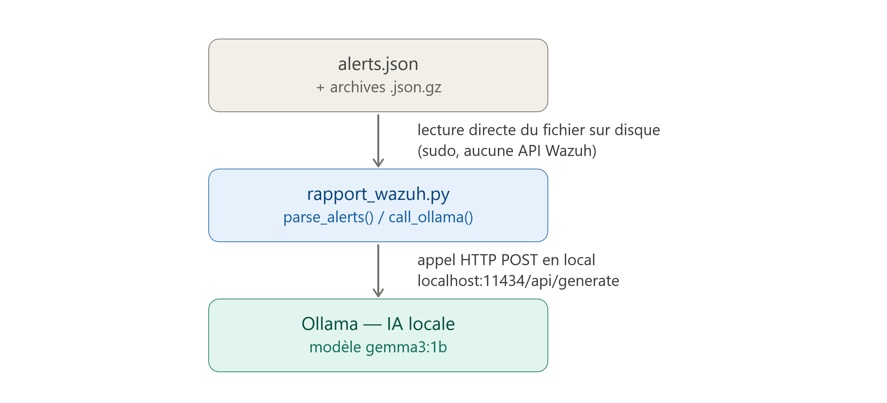

# Weekly Wazuh security report

<p align="center">
  <a href="README.md">English</a> &bull;
  <a href="README_fr.md">Français</a>
</p>


Wazuh is an open source SIEM/XDR platform. It collects logs from agents installed on machines, correlates them with detection rules, and generates real-time alerts. It also handles FIM, vulnerability detection, and compliance.

Python script that reads the alerts of a **Wazuh** SIEM, sorts and classifies them automatically, then generates an **Excel** report. When the local AI analysis is enabled, it also produces an explanatory **PDF**. Email delivery remains optional.

The program reads all these alerts automatically, performs the sorting, and decides which are just noise and which genuinely deserve attention. The script relies on a small artificial intelligence model running directly on the server locally, so nothing is exposed publicly, to explain each alert in simple and non-technical terms. There is also a safety rule: if an alert touches something potentially serious, it is always highlighted, never ignored, whether in Excel or in PDF. The script sends an email every day at the same time to a mailbox.

The goal: reduce the noise of a large volume of alerts and highlight the events that genuinely need review. The result depends on the Wazuh rules and on the data of each environment; no universal reduction rate is promised.

---

## Features

- Direct reading of the Wazuh alert logs (current file + `.gz` archives)
- Automatic classification of each significant alert: **Investigate**, **Review** or **False positive**
- "Security analyst" (SOC) logic applied **before** the AI, so that a sensitive alert is never hidden (CVE, malware, PowerShell, RDP, dropped executable...)
- Analysis completed by a **local AI** (Ollama), with no data sent outside
- Comparison with the previous week: trend, new rules, hosts on the rise
- **Excel** report in all modes; **PDF** when the local AI analysis is enabled
- **Automatic delivery by email** to the team

Architecture of the local AI analysis. The script reads the alert log directly from disk (without going through an API), then submits the alerts to the Ollama model through a local HTTP call, guaranteeing that no data leaves the server.



Integration of the Suricata IDS into Wazuh. Suricata analyses network traffic and writes its alerts to the eve.json file. Wazuh reads this file through a <localfile> block declared in ossec.conf, then ingests the IDS alerts and displays them in its dashboard. The whole setup runs on the same VM, so the communication happens by simply reading a file, with no network flow between the two tools.


---

## Deliverables overview

### Excel: summary tab


Overview: total number of alerts, how many are serious, and those to handle as a priority. The "trend" line shows the change compared with the previous week.

### Excel: detail of all alerts


The complete list. Each alert receives a verdict and an explanation; the columns are sortable and filterable.

### PDF: readable analysis, sorted by priority

<p>
  
  
</p>

The most readable version: each significant alert is summarised in three points, what it means, the likely cause, and the action to take.

---

## How it works

1. **Reading**: the script reads the Wazuh alert logs directly.
2. **Analysis**: it identifies the serious alerts, the most affected hosts and the noisy rules.
3. **Sorting**: SOC logic is applied, complemented by a local AI.
4. **Classification**: each significant alert receives a verdict (investigate / review / false positive).
5. **Reports**: generation of an Excel file; the AI analysis adds a readable PDF.
6. **Delivery**: optional, can be disabled with `--no-email`.

---

## The AI used

- **Tool**: [Ollama](https://ollama.com), running AI models locally
- **Model**: `gemma3:1b`
- **Settings**: temperature `0.1` (stable answers), short responses

The AI never decides on its own: any alert mentioning a CVE, a malware, PowerShell, RDP or a dropped executable is **forced to "investigate"**, whatever the opinion of the model.

---

## Requirements

- Python 3
- Read access to the Wazuh logs (`/var/ossec/logs/alerts/`)
- Libraries: `openpyxl`, `reportlab`, `requests`
- *(optional)* Ollama installed locally with the `gemma3:1b` model

---

## Installation

```bash
git clone https://github.com/Yukouf/script-wazuh-rapport.git
cd script-wazuh-rapport
pip install openpyxl reportlab requests
```

---

## Configuration

The secrets (SMTP credentials, recipients) are **never** written in the code.
They are read from environment variables.

Copy the provided template, then fill in the real values:

```bash
cp .env.example .env
# edit .env with the real values
```

Before running the script, load these variables into the session:

```bash
set -a && source .env && set +a
```

> ⚠️ The `.env` file contains the secrets: it is listed in `.gitignore` and must
> **never** be pushed to GitHub.

---

## Usage

```bash
sudo python3 rapport_wazuh.py                # report over 7 days (default)
sudo python3 rapport_wazuh.py --days 14      # custom period
sudo python3 rapport_wazuh.py --no-email     # generate without sending
sudo python3 rapport_wazuh.py --no-ai        # disable the AI analysis
```

> `--no-ai` does not require Ollama and generates the Excel file only. The PDF is a
> summary of the AI analysis: it therefore requires Ollama and the `reportlab` library.

`sudo` is used only to read the Wazuh logs.

---

## Documentation

The detailed operation, **code and explanations brought together section by section**, is in
[`GUIDE_TECHNIQUE_rapport_wazuh.md`](GUIDE_TECHNIQUE_rapport_wazuh.md).

---

## Project structure

```
.
├── rapport_wazuh.py     # main script
├── .env.example         # configuration template (without real values)
├── .env                 # the secrets, ignored by git, never committed
├── .gitignore
├──                 # screenshots used in this README
└── README.md
```

---

## Security

- Repository recommended as **private** (security monitoring code).
- **No secret in the code**: everything goes through `.env` + environment variables.
- If a credential has already been exposed, treat it as compromised and **regenerate it**.
